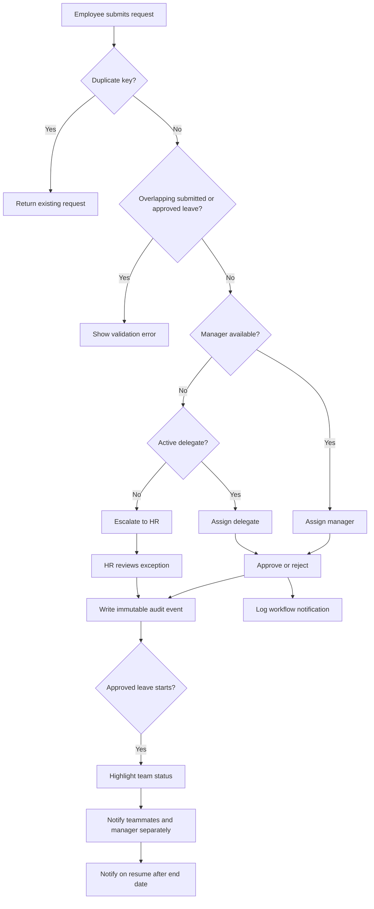
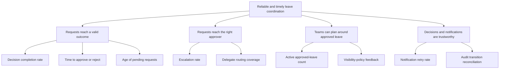

# WorkforceFlow Portfolio Package

## At A Glance

- **Role:** Product Manager / Product Owner, self-directed project
- **Stage:** MVP
- **Product:** Leave-request routing, team availability, and HR exception handling
- **Validation:** Eight integration acceptance tests pass against in-memory SQLite
- **Demo:** `http://localhost:5187` (local only; deploy before sharing externally)

## 1. PRD

### Problem Hypothesis

Employees, managers, and project teams need a clear path for leave requests and timely visibility into approved absences. Unclear approval ownership can leave requests waiting, while teams may not know when a colleague is unavailable.

This is a product hypothesis, not a result of completed user research.

### Users

- Employees submit leave requests and need status visibility.
- Managers and delegates review requests and coordinate coverage.
- HR handles requests that cannot be routed to an available approver.
- Project teammates need availability status for planning.

### Product Goal

Make leave requests traceable from submission to decision, route each request to an available approver, and make approved leave visible to the right people.

### MVP Scope

- Employee request submission with idempotency and overlapping-date validation.
- Manager approval or rejection, delegation routing, and HR escalation.
- Immutable audit events for request creation and status transitions.
- Team rosters with approved-leave status and separate manager/team notifications.
- Unread notification count and recipient-owned read state.
- Dashboard counts for Submitted, Approved, Rejected, Escalated, and Abandoned.

### Key Acceptance Criteria

- Repeated idempotency keys do not create duplicate requests.
- Submitted or approved overlapping requests are blocked for the same employee.
- Out-of-office managers route to an active delegate, or to HR when no delegate is active.
- Only a request's assigned manager can approve or reject it; HR access is restricted to HR.
- Notification failure does not roll back a saved request decision.
- Teammates see leave status but not leave dates; the project manager and HR can see dates.
- Each notification can be marked read only by its recipient.

### Non-Goals For This MVP

- Production authentication, enterprise authorization, or employee identity integration.
- Email, SMS, or real-time push delivery.
- Automatic retry execution for notifications marked `RetryRequired`.
- Payroll, accrual balances, calendar integrations, or leave policy configuration.

## 2. Workflow

## 3. Functioning Prototype

The ASP.NET Core 8 Razor Pages app uses EF Core and local SQLite (`workforceflow.db`). Three seeded project teams provide synthetic demo data.

| Page | Portfolio walkthrough |
|---|---|
| `/Requests/Create` | Submit a request and see status or validation feedback. |
| `/Approvals` | Review requests as the assigned manager or delegate. |
| `/HR/Exceptions` | Review escalations and audit entries with actor names. |
| `/Teams` | See scoped roster visibility, leave highlights, alerts, and read controls. |
| `/Dashboard` | View database-backed status counts and demo routing controls. |

**Demo warning:** `http://localhost:5187` is accessible only on the developer's machine. Deploy a demo and use synthetic data before linking it from a public portfolio. The role switcher is a test control, not authentication.

## 4. Dashboard Evidence

The dashboard currently shows raw request counts grouped by status:

| Card | Current source |
|---|---|
| Submitted | `LeaveRequests` where `Status = Submitted` |
| Approved | `LeaveRequests` where `Status = Approved` |
| Rejected | `LeaveRequests` where `Status = Rejected` |
| Escalated | `LeaveRequests` where `Status = Escalated` |
| Abandoned | `LeaveRequests` where `Status = Abandoned` |

Capture a screenshot of `/Dashboard` for the portfolio. Do not present seeded counts as real adoption or business outcomes.

## 5. Metric Tree

| Metric | Definition | Availability and caveat |
|---|---|---|
| Status distribution | Count requests by current status at a point in time. | Available now; shown on Dashboard. |
| Decision completion rate | Approved or rejected requests divided by requests submitted in a chosen cohort. | Derivable from statuses; define the cohort window before comparing periods. |
| Decision time | `ApprovedAt` or `RejectedAt` minus `SubmittedAt`, for decided requests. | Derivable for approved/rejected requests; report median and p90. |
| Pending age | Current time minus `SubmittedAt` for Submitted or Escalated requests. | Derivable; report median and p90. |
| Escalation rate | Escalated requests divided by requests submitted in the same cohort. | Derivable from request statuses. |
| Notification retry rate | Notification rows with `RetryRequired = true` divided by notification attempts. | Derivable; there is no automated retry executor yet. |
| Audit reconciliation | Expected creation and status-transition events compared with matching audit rows. | Covered by integration tests; run as a data-quality check over a defined period. |
| Visibility-policy acceptance | Employee and manager feedback on leave-status/date visibility. | Requires user interviews or usability testing; not currently measured. |

Do not report duplicate attempts or conflict-rejection rates as measured: rejected attempts are not persisted as events in the current model. No baselines or targets have been established.

## 6. Business Case

### Value Hypothesis

If requests have an explicit owner, exceptions route to HR, and teams receive appropriate availability updates, then users may spend less effort chasing status and coordinating coverage. The MVP tests the workflow mechanics; it has not yet demonstrated time savings or financial return.

### Costs And Risks To Validate

- Employee, manager, and HR time to submit, review, and resolve exceptions.
- Privacy expectations for showing leave status and dates to different audiences.
- Local time-zone behavior for start and resume events.
- Production authentication, authorization, database migrations, and notification delivery.

### Measurement Plan

Establish baselines for decision time, pending age, escalation rate, and notification retries. Test the visibility policy with employees and managers. Set targets only after understanding baseline performance and policy requirements.

## 7. Decision Log

| Decision | Rationale | Trade-off / next validation |
|---|---|---|
| Use an idempotency key | Prevent repeat submissions from creating duplicate requests. | Duplicate-attempt volume is not currently instrumented. |
| Block overlapping active requests | Avoid conflicting submitted or approved leave for one employee. | Validate behavior against company-specific leave policies. |
| Route manager, then delegate, then HR | Keep a clear approval owner when the manager is unavailable. | Validate delegation rules and escalation ownership with HR. |
| Show status to teammates, dates to manager/HR | Support team planning while limiting leave detail exposure. | Validate privacy expectations with representative users. |
| Persist audit events with status changes | Make decisions traceable and support reconciliation. | Production retention and access policy still need definition. |
| Keep notification failure separate from request save | Avoid losing an approval because notification delivery fails. | Failures are marked for retry; automatic retry is not implemented. |
| Use SQLite and an additive MVP schema | Keep local setup simple and preserve existing demo data during updates. | Use migrations and a managed database before production. |

